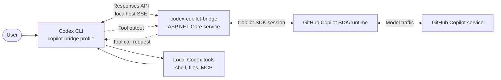
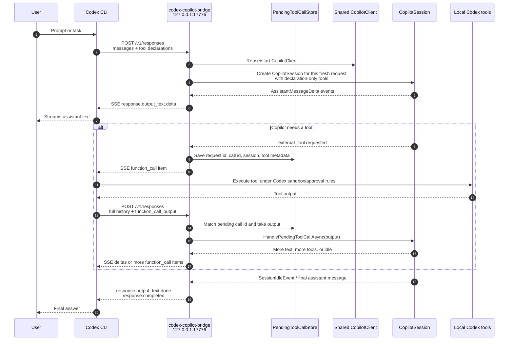

# Codex Copilot Bridge

Local bridge for experimenting with GitHub Copilot as a Codex CLI inference provider.

## Architecture

The bridge is a loopback ASP.NET Core service that speaks Codex's OpenAI Responses-compatible provider protocol on one side and the GitHub Copilot SDK protocol on the other. Codex still owns local tool execution, sandboxing, approvals, and workspace writes; the bridge only translates model text, tool declarations, tool-call requests, and tool outputs between the two protocols.

At a high level, Codex talks to the bridge as a local Responses API provider, while the bridge keeps the Copilot conversation moving through the GitHub Copilot SDK:



The detailed request lifecycle is:



Key lifecycle details:

- The Copilot client is shared and reused so each request does not restart the Copilot runtime.
- Fresh Codex requests create fresh Copilot sessions because Codex sends full conversation history; pending tool-output follow-ups resume the existing session attached to the pending call.
- Pending tool calls are kept in memory with a TTL so long-running Codex tool executions can return later.
- Text deltas are streamed immediately over Server-Sent Events; final completion events are emitted once the Copilot turn is idle or waiting on Codex tool output.
- Copilot tools are declaration-only in bridge mode. Codex remains the only process that executes shell, filesystem, MCP, and other local tools.

## Quick Setup on macOS

Prerequisites:

- macOS arm64.
- GitHub account with Copilot access.
- `codex` CLI installed and working.
- `gh` CLI authenticated to GitHub if installing from GitHub Actions artifacts.

The default bridge mode is `CopilotBridge`: Codex sends its tool declarations to the bridge, Copilot can request those declaration-only tools, and Codex remains the executor for shell, filesystem, MCP, and other tool calls.

### 1. Install the launchd service from GitHub

```bash
REPO=findyoucef/codex-copilot-bridge
WORKDIR="$(mktemp -d)"
cd "$WORKDIR"

RUN_ID="$(gh run list \
  --repo "$REPO" \
  --branch main \
  --workflow ci.yml \
  --status success \
  --limit 1 \
  --json databaseId \
  --jq '.[0].databaseId')"

gh run download "$RUN_ID" \
  --repo "$REPO" \
  --name codex-copilot-bridge-osx-arm64

tar -xzf codex-copilot-bridge-osx-arm64.tar.gz

mkdir -p scripts ops/launchd

gh api "repos/$REPO/contents/scripts/install-macos-launchd.sh?ref=main" \
  --jq .content | base64 -D > scripts/install-macos-launchd.sh

gh api "repos/$REPO/contents/scripts/uninstall-macos-launchd.sh?ref=main" \
  --jq .content | base64 -D > scripts/uninstall-macos-launchd.sh

gh api "repos/$REPO/contents/ops/launchd/com.findyoucef.codex-copilot-bridge.plist?ref=main" \
  --jq .content | base64 -D > ops/launchd/com.findyoucef.codex-copilot-bridge.plist

chmod +x scripts/*.sh
scripts/install-macos-launchd.sh ./codex-copilot-bridge-osx-arm64
```

Verify the service:

```bash
curl -fsS http://127.0.0.1:17776/healthz
launchctl print "gui/$(id -u)/com.findyoucef.codex-copilot-bridge"
```

Logs are written to:

```text
~/Library/Logs/codex-copilot-bridge/stdout.log
~/Library/Logs/codex-copilot-bridge/stderr.log
```

If the GitHub Actions artifact has expired, clone the repository and build locally instead:

```bash
git clone https://github.com/findyoucef/codex-copilot-bridge.git
cd codex-copilot-bridge
scripts/publish-osx-arm64.sh
scripts/install-macos-launchd.sh
```

### 2. Authenticate Copilot for the bridge

The bridge uses an isolated Copilot home at `~/.codex-copilot-bridge/copilot-home`. Authenticate that home once:

```bash
COPILOT_BIN="$HOME/.local/share/codex-copilot-bridge/runtimes/osx-arm64/native/copilot"
COPILOT_HOME="$HOME/.codex-copilot-bridge/copilot-home" "$COPILOT_BIN" login
```

The command opens GitHub's device login flow and prints a code. Complete the browser step before running Codex through the bridge.

### 3. Add a Codex profile

Codex profiles live in `~/.codex/<profile-name>.config.toml`. Create a `copilot-bridge` profile:

```bash
mkdir -p "$HOME/.codex"

cat > "$HOME/.codex/copilot-bridge.config.toml" <<'EOF'
model = "gpt-5.5"
model_provider = "github-copilot-bridge"
model_reasoning_effort = "medium"

[model_providers.github-copilot-bridge]
name = "GitHub Copilot Bridge"
base_url = "http://127.0.0.1:17776/v1"
wire_api = "responses"
requires_openai_auth = false
supports_websockets = false
stream_idle_timeout_ms = 3600000
EOF
```

Use the profile directly:

```bash
codex --profile copilot-bridge
codex exec --profile copilot-bridge "Reply exactly: copilot-profile-ok"
```

Plain `codex` and `codex exec` still use your normal Codex provider.

### 4. Optional zsh helpers

These helpers make switching explicit without changing your default Codex config:

```bash
cat > "$HOME/.codex-copilot-bridge.zsh" <<'EOF'
codex-copilot() {
  command codex --profile copilot-bridge "$@"
}

codex-copilot-exec() {
  command codex exec --profile copilot-bridge "$@"
}

codex-default() {
  command codex "$@"
}

codex-default-exec() {
  command codex exec "$@"
}

codex-copilot-health() {
  curl -fsS http://127.0.0.1:17776/healthz
  printf '\n'
}
EOF

if ! grep -q 'codex-copilot-bridge' "$HOME/.zshrc"; then
  cat >> "$HOME/.zshrc" <<'EOF'

# >>> codex-copilot-bridge >>>
if [ -f "$HOME/.codex-copilot-bridge.zsh" ]; then
  source "$HOME/.codex-copilot-bridge.zsh"
fi
# <<< codex-copilot-bridge <<<
EOF
fi

source "$HOME/.zshrc"
```

Use Copilot-backed Codex:

```bash
codex-copilot
codex-copilot-exec "Reply exactly: copilot-profile-ok"
codex-copilot-health
```

Switch back to the default provider:

```bash
codex
codex exec "Reply with the active model name."

# Or, if you prefer explicit helper names:
codex-default
codex-default-exec "Reply with the active model name."
```

### 5. Smoke test the full tool loop

This test verifies the important path: Copilot requests a tool, Codex executes it, and the bridge returns the tool output back to Copilot.

```bash
codex exec --profile copilot-bridge --skip-git-repo-check \
  --output-last-message /tmp/codex-copilot-tool-smoke.out \
  'Use the shell_command tool to run: printf codex-copilot-tool-ok. Then reply with exactly the command output and no other text.'

cat /tmp/codex-copilot-tool-smoke.out
```

Expected output:

```text
codex-copilot-tool-ok
```

## Service Management

Useful install overrides:

```bash
CODEX_COPILOT_BRIDGE_PORT=17776 \
CODEX_COPILOT_BRIDGE_INSTALL_DIR="$HOME/.local/share/codex-copilot-bridge" \
CODEX_COPILOT_BRIDGE_LOG_DIR="$HOME/Library/Logs/codex-copilot-bridge" \
scripts/install-macos-launchd.sh
```

Uninstall the launchd service:

```bash
scripts/uninstall-macos-launchd.sh
```

Remove installed files and logs too:

```bash
scripts/uninstall-macos-launchd.sh --remove-files
```

The health response includes `pending_tool_calls`, `active_copilot_sessions`, `oldest_pending_tool_call_age_seconds`, `pending_tool_call_ttl_seconds`, and `request_timeout_seconds`.

## Development

Run from source:

```bash
dotnet run --project CodexCopilotBridge/CodexCopilotBridge.csproj --urls http://127.0.0.1:17776
```

Package locally:

```bash
scripts/publish-osx-arm64.sh
```

This creates:

```text
artifacts/publish/codex-copilot-bridge-osx-arm64/
artifacts/dist/codex-copilot-bridge-osx-arm64.tar.gz
```

The archive is also produced by GitHub Actions on pushes to `main`.

## Development Modes

Set `Bridge:Mode` to `Echo` to test the Codex provider contract without spending Copilot quota or depending on auth state.

Set `Bridge:Mode` to `CopilotSdk` for text-only Copilot streaming without tool bridging.

The default profile and bridge fallback use `gpt-5.5`. If Copilot rejects that model for your account, set the profile `model` and `Bridge:DefaultModel` to another Copilot-supported model slug.

```bash
dotnet test
```

Echo-mode smoke run:

```bash
Bridge__Mode=Echo dotnet run --project CodexCopilotBridge/CodexCopilotBridge.csproj --urls http://127.0.0.1:17776
```

Tool-loop probe:

```bash
Bridge__Mode=ToolProbe dotnet run --project CodexCopilotBridge/CodexCopilotBridge.csproj --urls http://127.0.0.1:17776
```

Then point Codex at the bridge. The probe backend emits a `shell_command` function call, waits for Codex to execute it, and summarizes the returned `function_call_output`.

Copilot external-tool probe:

```bash
Bridge__Mode=CopilotToolProbe dotnet run --project CodexCopilotBridge/CodexCopilotBridge.csproj --urls http://127.0.0.1:17776
```

This probe registers a declaration-only `bridge_echo` tool with Copilot, responds to the SDK's `external_tool.requested` event through the pending-tool RPC, and returns Copilot's final answer.

Codex smoke command:

```bash
codex exec --profile copilot-bridge --skip-git-repo-check \
  --json 'Run the Copilot external tool probe.'
```

The probe verifies Copilot external-tool request/response handling through the same provider profile used in the quick setup.

## Lifecycle Settings

```json
{
  "Bridge": {
    "RequestTimeout": "01:00:00",
    "PendingToolCallTtl": "01:00:00",
    "PendingToolCallCleanupInterval": "00:01:00",
    "ToolRequestBatchQuietPeriod": "00:00:00.500",
    "ResponseOutputChannelCapacity": 512
  }
}
```

`RequestTimeout` caps each active `/v1/responses` bridge operation. `PendingToolCallTtl` caps how long a Copilot session can wait for Codex to return tool output, including long-running local shell commands. The cleanup service disposes expired sessions on `PendingToolCallCleanupInterval`. `ToolRequestBatchQuietPeriod` waits briefly for adjacent parallel Copilot tool calls before returning them to Codex. `ResponseOutputChannelCapacity` bounds queued stream events so slow clients apply backpressure instead of allowing unbounded memory growth.

## CI

`.github/workflows/ci.yml` runs restore, tests, build, and an osx-arm64 self-contained publish. The publish job uploads `codex-copilot-bridge-osx-arm64.tar.gz` for non-PR runs.
